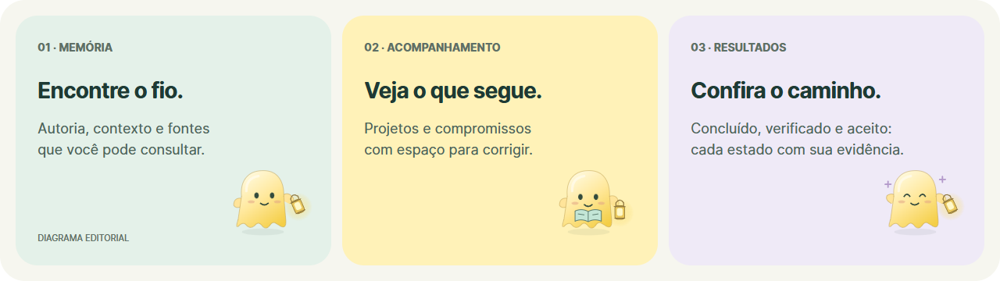

<p align="center">
  
</p>

<p align="center"><strong>Retome o fio da conversa. Encontre a fonte. Veja o que vem depois.</strong></p>

Lume reúne memória de conversas autorizadas, compromissos e projetos em um aplicativo desktop. O contexto fica ligado à sua origem; sugestões podem ser corrigidas e resultados têm estados distintos de conclusão, verificação, envio e aceite.

**LUME 1.0 · prévia desktop · técnica `3.2.0-beta.9`**

[Conheça o produto](#um-lugar-para-recuperar-o-contexto) · [Experiência e privacidade](docs/lume-soft/README.md) · [Desenvolvimento](#desenvolvimento) · [Documentação](docs/README.md) · [Estado da entrega](DONE.md)

**Prévia em validação.** A beta.9 corrige o espaçamento das telas e acrescenta prova do áudio sintetizado. A versão instalada permanece beta.7; o bloqueio anterior ocorreu no script, antes do instalador. Organização com dados reais, aceite de utilidade, macOS e hardware de 8 GB ainda têm validações pendentes. Consulte o [estado da entrega](DONE.md), os [ajustes atuais](docs/lume-soft/AJUSTES-LAYOUT-SOM.md) e o [registro anterior](docs/lume-soft/VERIFICACAO.md).

Este repositório é privado e começa com um snapshot curado. O [histórico anterior](docs/ORIGEM.md), seus commits e worktrees foram preservados; dados pessoais ficam fora deste conteúdo.

## Um lugar para recuperar o contexto

| Percurso | O que você encontra |
| --- | --- |
| **Agora** | O que precisa de atenção, o que segue em acompanhamento e o que aconteceu. |
| **Memória** | Uma timeline com autoria, data, filtros e acesso às fontes. |
| **Vendas** | Oportunidades e compromissos, com distinção entre sugestão e informação confirmada. |
| **Projetos** | Contexto, vínculos, entregas e resultados com seus estados de verificação. |
| **Pessoas** | Pessoas, grupos e organizações, preservando suas diferenças e relações. |



A companhia Lume é opcional: um personagem com lanterna acompanha estados do aplicativo. Tema, movimento e som têm controles próprios; pausar a companhia é independente de pausar o atendimento.


**Uma presença leve.** Treze expressões, pequenas surpresas e movimento finito. O personagem responde ao estado do aplicativo, respeita movimento reduzido e permanece silencioso até você escolher ouvir.

**Seu ritmo, no seu computador.** O acompanhamento opcional estima o tempo dos aplicativos em primeiro plano. Você pode iniciar, pausar, excluir aplicativos, definir retenção e apagar os registros no painel. Não lê títulos, páginas, conteúdo, capturas ou teclas. Esses registros não são enviados ao ChatGPT e não compõem o backup do acervo. [Como funciona](docs/lume-soft/ATIVIDADE.md).

## Dados, fontes e autorização

Armazenamento e busca têm base local. A organização com a conta ChatGPT existente depende de autorização das fontes, configuração e avaliação aprovada; ela envolve processamento remoto. Lume não deve tratar acesso de leitura como permissão de envio. Correções manuais prevalecem, e alterações ou revogações invalidam resultados que perderam sua autorização.

O [contrato atual](docs/lume-soft/CONTRATO.md) acrescenta a experiência suave e o acompanhamento local ao [contrato de organização](docs/lume-1/CONTRATO.md), que detalha rastreabilidade, consentimento e verificação.

## Desenvolvimento

Pré-requisitos: **Node.js 24 ou superior**, npm e Git. Os comandos abaixo são executados na raiz deste repositório. No PowerShell, use `npm.cmd` caso a política local impeça o atalho `npm.ps1`; não altere a política para executar o projeto.

```sh
npm ci
npm test
```

Para abrir a aplicação de desenvolvimento:

```sh
npm run desktop
```

O desktop usa o perfil `AssessorDesktop` na pasta de dados do usuário. Esse comando abre o aplicativo e pode acessar o perfil configurado: confira o ambiente e a recuperação dos dados antes de usá-lo em uma máquina com instalação existente. Fixtures e provas automatizadas ficam separadas do perfil pessoal.

| Comando | Finalidade |
| --- | --- |
| `npm test` | Testes Node do projeto. |
| `npm run test:desktop` | Ensaio desktop; inicia Electron e tem pré-requisitos de ambiente. |
| `npm run release:preflight` | Verifica os requisitos para preparar uma candidata. |
| `npm run desktop:build` | Prepara NSIS Windows com publicação desativada; exige os recursos e hooks de build. |
| `npm run desktop:mac:check` | Confere requisitos de distribuição em um Mac autorizado. |
| `npm run mcp:pack` | Prepara a extensão MCP a partir dos módulos e manifesto do projeto. |

Build de desenvolvimento não comprova assinatura, instalação ou distribuição. O [registro desktop atual](docs/lume-soft/DESKTOP.md) acompanha a beta.8; o [registro anterior](docs/lume-1/DESKTOP.md) conserva a experiência da beta.7. A [documentação](docs/README.md) reúne os demais pontos de entrada.

O hook Windows fixa o filtro de compressão `BCJ`, compatível com o extrator NSIS desta versão do empacotador. Ao usar `electron-builder --prepackaged`, que pula esse hook, defina antes `ELECTRON_BUILDER_7Z_FILTER=BCJ` no ambiente do comando. O instalador deve ser conferido por comparação dos arquivos instalados; saída zero, isoladamente, não prova uma instalação completa.

## Organização do repositório

```text
desktop/       Electron, janela, companhia e identidade
src/           domínio, fontes, filas, dados locais e integrações
src/painel/    interface do aplicativo
bin/           entradas de linha de comando
mcpb/          manifesto e servidor da extensão MCP
native/        recursos nativos e seus contratos
scripts/       build, verificação e manutenção
test/          testes e fixtures controladas
docs/          contratos, decisões, evidências e apresentação
```

O produto nasceu como Assessor 2.0. Alguns nomes internos, identificadores e caminhos foram preservados para manter compatibilidade com perfis existentes. O histórico anterior permanece no repositório de origem; nomes antigos não definem a apresentação atual do produto.

Para contribuir, leia [CONTRIBUTING.md](CONTRIBUTING.md). Para continuar uma tarefa, recupere [DONE.md](DONE.md), [AGENTS.md](AGENTS.md) e o contrato correspondente. O repositório é privado; credenciais, sessões, conversas, bancos pessoais e capturas privadas ficam fora do Git.
