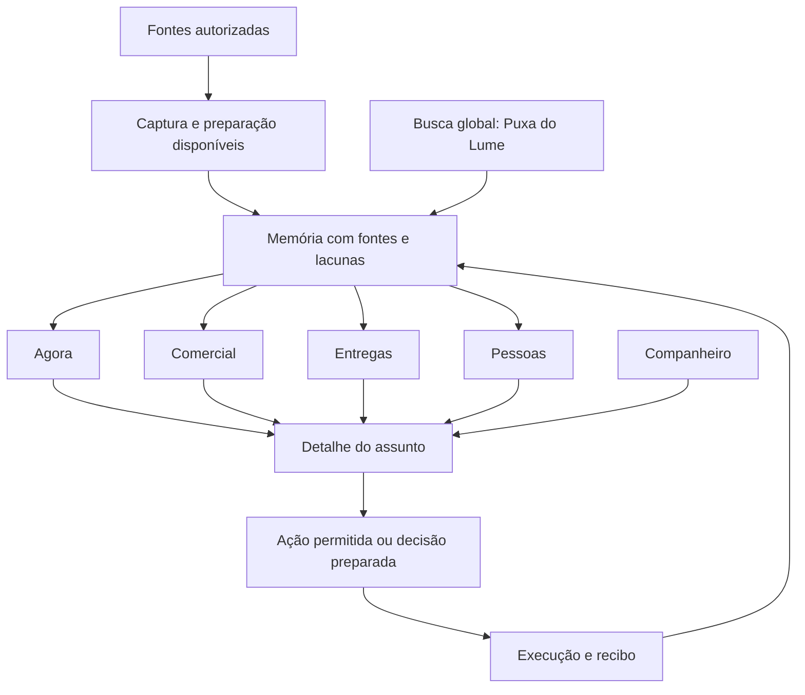

# Fluxos e estados

Primeiro acesso: consentimento vigente→WhatsApp→captura disponível→primeira informação recuperada. Explorar memória continua disponível se conexão/IA/Telegram falhar. Busca→trecho→fonte preserva pessoa/data; fechar detalhe devolve foco e rolagem. Pessoas→atendimento→pausa/retomada explícita revalida backend; grupos/excluídos nunca recebem habilitação de envio.

| Estado em todas as superfícies | Comportamento |
|---|---|
| Carregando | status com tarefa; prazo limitado; navegação livre |
| Vazio | ausência concreta, sem dados de exemplo; acesso à fonte/conexão pertinente |
| Sucesso | conteúdo e atualização com fonte |
| Erro recuperável | mensagem útil e tentar novamente; não repetir mutação incerta |
| Desconexão | memória existente acessível; captura/conexão/processamento separados |
| Parcial | lacunas/recorte/paginação explícitos, sem afirmar totalidade |
| Sem permissão | conteúdo removido/ação indisponível; backend revalida |
| Desatualizado | data da consulta e atualizar; nunca estado antigo promovido a atual |

Diálogos de aprovação exibem destinatário e conteúdo exatos; nova mensagem invalida aprovação conforme serviço atual. Exportação/termos/manutenção/atualização/erros preservam seus contratos. Longo processamento informa progresso disponível, nunca porcentagem inventada.
